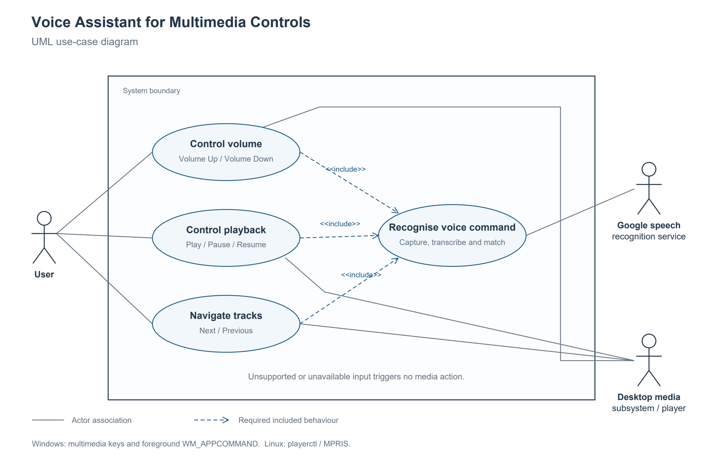

# UML use-case diagram

This diagram describes the implemented voice assistant on `main`. It shows user goals, external actors, the system boundary and the recognition behaviour shared by the media-control use cases.

- [SVG vector image](use-case.svg) for scaling and inclusion in the project report.
- [PNG image](use-case.png) for direct viewing and presentations.
- [Editable PlantUML model](use-case.puml) for changes and rendering with a PlantUML-compatible tool.

## Actors and use cases

The **User** requests media actions. The **Google speech recognition service** transcribes captured speech. The **Desktop media subsystem / player** receives the requested actions through Windows multimedia controls or Linux playerctl/MPRIS.

| Use case | Supported commands or behaviour | SRS requirements |
| --- | --- | --- |
| Control volume | Volume Up and Volume Down; supported aliases | FR-06 and FR-07 |
| Control playback | Play, Pause and Resume | FR-08 to FR-10 |
| Navigate tracks | Next and Previous; supported aliases | FR-11 and FR-12 |
| Recognise voice command | Capture a phrase, obtain a transcription and match the allowed vocabulary | FR-01 to FR-05 |

Solid lines are actor associations. A dashed `<<include>>` arrow points from a media-control use case to the recognition behaviour it requires. These relationships express required behaviour, not the sequence of execution. Crossing lines do not represent junctions.

## Scope and limitations

The first three use cases group all seven supported actions. Unsupported phrases and unavailable input produce safe feedback and no media action; backend failures are handled at the feature boundary (FR-13 to FR-15). They are alternative outcomes, rather than additional user goals in this view.

This is a use-case view, not a code class diagram or a processing flowchart. It does not claim independent verification of playback state or completion of physical system acceptance. ESP32 firmware is outside the current merged desktop implementation. See [the SRS](../SRS.md), [architecture](../SAD.md) and [validation checklist](../VALIDATION.md) for those details.
